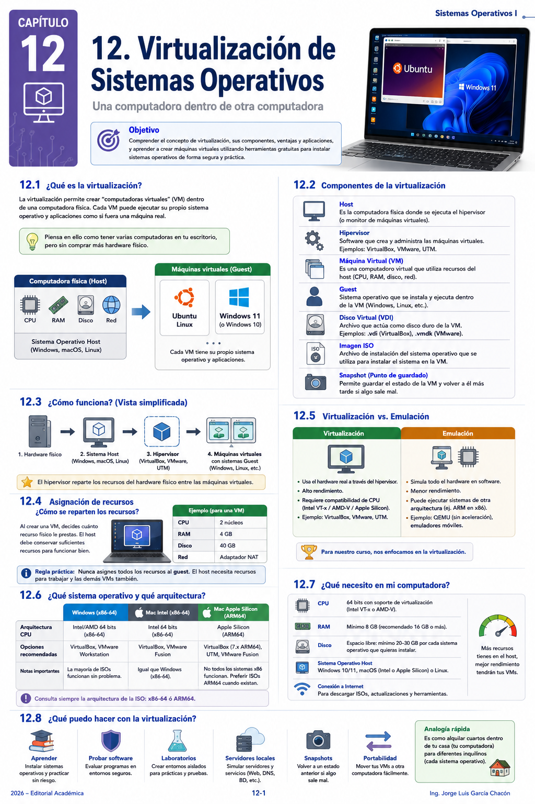
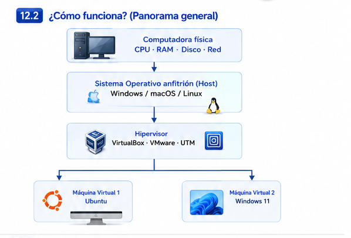
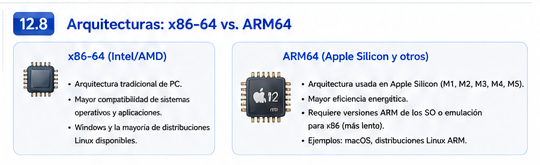
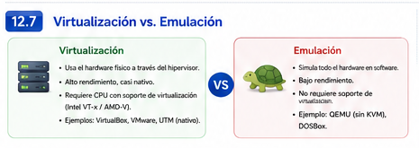
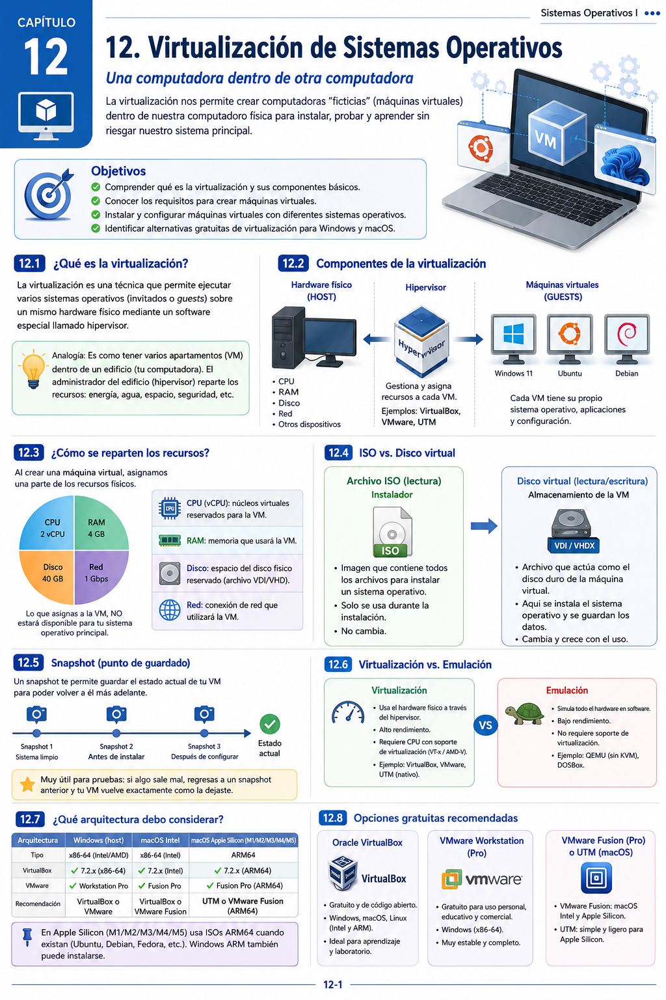

# Capítulo 12. Virtualización de Sistemas Operativos

## De una computadora... a varias computadoras

Hasta ahora hemos estudiado cómo el Sistema Operativo administra procesos, recursos, hardware e interbloqueos. Ahora utilizaremos esos conocimientos para comprender una tecnología que permite ejecutar **varios sistemas operativos sobre un mismo equipo físico**.

Imaginemos una computadora con:

- procesador;
- 16 GB de memoria RAM;
- 512 GB de almacenamiento;
- conexión de red;
- Windows, macOS o Linux como sistema principal.

La pregunta es:

> **¿Podemos utilizar parte de esos recursos para construir otra computadora sin comprar otro equipo físico?**

Sí. Esa es precisamente una de las ideas fundamentales de la **virtualización**.

::: {.callout-tip title="Idea central"}
Una máquina virtual se comporta como una computadora independiente, pero utiliza recursos proporcionados por una computadora física.
:::

{fig-align="center" width="92%"}

---

# Objetivos de aprendizaje

Al finalizar este capítulo, el estudiante será capaz de:

- Explicar qué es la virtualización y por qué se utiliza.
- Diferenciar **host**, **guest**, **máquina virtual** e **hipervisor**.
- Comprender cómo CPU, RAM, almacenamiento y red físicos se presentan como recursos virtuales.
- Diferenciar **virtualización** de **emulación**.
- Reconocer la importancia de la arquitectura **x86-64** y **ARM64**.
- Identificar alternativas gratuitas actuales para Windows y macOS.
- Seleccionar una herramienta de virtualización de acuerdo con el equipo disponible.
- Comprender qué es una imagen ISO, un disco virtual y un snapshot.
- Diseñar la configuración básica de una máquina virtual antes de instalarla.

---

# 1. ¿Qué es la virtualización?

La **virtualización** permite crear una representación lógica de recursos informáticos físicos.

En lugar de que un único Sistema Operativo utilice directamente todos los recursos del equipo, un software de virtualización puede proporcionar recursos a una o varias **máquinas virtuales (VM)**.

```{mermaid}
%%| fig-width: 7.2
%%| fig-height: 5.4
%%| fig-align: center
flowchart TB
    HW["Computadora física<br/>CPU · RAM · Disco · Red"]
    HOST["Sistema Operativo anfitrión<br/>(Host)"]
    HYP["Hipervisor<br/>VirtualBox · VMware · UTM"]
    VM1["Máquina Virtual 1<br/>Ubuntu"]
    VM2["Máquina Virtual 2<br/>Windows"]
    HW --> HOST
    HOST --> HYP
    HYP --> VM1
    HYP --> VM2
```

{fig-align="center" width="88%"}

::: {.callout-note title="Primera analogía"}
Pensemos en un edificio.

El **hardware físico** es el edificio completo. El hipervisor divide y administra espacios. Cada **máquina virtual** es como un apartamento: tiene sus propios recursos y puede funcionar de manera relativamente independiente, aunque todos comparten la misma infraestructura física.
:::

---

# 2. Cuatro conceptos que no debemos confundir

| Concepto | Significado |
|---|---|
| **Host** | Computadora y Sistema Operativo principal donde ejecutamos la virtualización |
| **Guest** | Sistema Operativo instalado dentro de una máquina virtual |
| **VM** | Computadora virtual que recibe CPU, RAM, disco, red y otros dispositivos virtuales |
| **Hipervisor** | Software o capa que crea y administra las máquinas virtuales |

## Ejemplo

Supongamos que tenemos una Mac con macOS y ejecutamos Ubuntu mediante una VM:

```text
Mac física       → Hardware
macOS            → Host
VMware/UTM       → Hipervisor
Máquina Ubuntu   → VM
Ubuntu           → Guest
```

::: {.callout-important title="Pregunta para el grupo"}
Si utilizamos una computadora con Windows 11 para ejecutar una máquina virtual con Ubuntu:

**¿Cuál es el host y cuál es el guest?**
:::

---

# 3. ¿De dónde salen los recursos de la VM?

La máquina virtual **no crea recursos físicos de la nada**.

Si nuestro equipo tiene:

```text
CPU:    8 núcleos
RAM:    16 GB
Disco:  512 GB
```

podríamos configurar una VM con:

```text
CPU virtual:     2 núcleos
RAM virtual:     4 GB
Disco virtual:  40 GB
```

```{mermaid}
%%| fig-width: 7.3
%%| fig-height: 4.7
%%| fig-align: center
flowchart LR
    F["Equipo físico<br/>8 CPU · 16 GB RAM · 512 GB"]
    V["VM<br/>2 CPU · 4 GB RAM · 40 GB"]
    R["Recursos restantes<br/>continúan disponibles<br/>para el host y otras tareas"]
    F -->|"asignamos una parte"| V
    F --> R
```

::: {.callout-warning title="No debemos entregar todo a la VM"}
El Sistema Operativo anfitrión también necesita CPU y RAM. Asignar demasiados recursos a una VM puede hacer lento al host y, paradójicamente, empeorar toda la experiencia.
:::

---

# 4. Una VM no es simplemente otra ventana

Cuando abrimos una VM vemos una ventana, pero detrás existe una computadora virtual completa.

El hipervisor puede presentar al guest:

- procesadores virtuales;
- memoria RAM;
- almacenamiento;
- tarjeta de red;
- controlador gráfico;
- dispositivos USB;
- firmware virtual;
- otros dispositivos.

El guest utiliza esos dispositivos como si pertenecieran a una computadora real.

---

# 5. ¿Para qué virtualizamos?

La virtualización resulta especialmente útil para:

- aprender otros Sistemas Operativos;
- practicar administración sin modificar el equipo principal;
- probar software;
- construir laboratorios;
- simular servidores;
- realizar pruebas de redes;
- crear entornos aislados;
- probar configuraciones antes de utilizarlas en producción;
- ejecutar aplicaciones que requieren otro Sistema Operativo.

::: {.callout-tip title="En nuestro curso"}
Una VM funciona como un **laboratorio dentro de nuestra computadora**. Podemos experimentar, equivocarnos, reinstalar y volver a intentar sin tener que modificar directamente el Sistema Operativo principal.
:::

---

# 6. ¿Qué ocurre si algo sale mal?

Una de las ventajas de una VM es el aislamiento.

Un error dentro del guest normalmente no significa que tengamos que reinstalar el host.

Además, muchas plataformas permiten crear **snapshots**.

## Snapshot: el punto de guardado

Podemos imaginar un snapshot como el **punto de guardado de un videojuego**.

```text
VM recién instalada
       ↓
[Snapshot A]
       ↓
Instalamos programas
       ↓
[Snapshot B]
       ↓
Hacemos una prueba peligrosa
       ↓
Algo sale mal
       ↓
Regresamos al Snapshot B
```

::: {.callout-warning title="Snapshot no significa backup completo"}
Un snapshot es muy útil para regresar rápidamente a un estado anterior de una VM, pero no debe confundirse con una estrategia completa de copias de seguridad.
:::

---

# 7. ISO, disco virtual y Sistema Operativo

Estos conceptos suelen confundirse al comenzar.

## Imagen ISO

Una **ISO** contiene una imagen de un medio de instalación.

Podemos imaginarla como el equivalente digital del DVD o USB desde el cual instalaríamos un Sistema Operativo.

## Disco virtual

Es un archivo que el guest interpreta como si fuera un disco duro o SSD.

En VirtualBox es común encontrar formatos como **VDI**; otras plataformas utilizan formatos diferentes.

## La relación

```{mermaid}
%%| fig-width: 7
%%| fig-height: 4.3
%%| fig-align: center
flowchart LR
    ISO["Imagen ISO<br/>instalador"]
    VM["Máquina virtual"]
    VD["Disco virtual"]
    OS["Sistema Operativo<br/>instalado"]
    ISO --> VM
    VM --> VD
    VD --> OS
```

::: {.callout-note title="Una comparación sencilla"}
**ISO = instalador.**  
**Disco virtual = lugar donde quedará instalado el Sistema Operativo.**
:::

---

# 8. Antes de descargar: x86-64 y ARM64

{fig-align="center" width="88%"}

Este es uno de los cambios más importantes respecto de muchos materiales antiguos de virtualización.

Actualmente podemos encontrar computadoras con diferentes arquitecturas.

## x86-64

Es común en equipos con procesadores:

- Intel;
- AMD.

## ARM64

Actualmente aparece, entre otros, en:

- Mac con Apple Silicon;
- algunos equipos Windows con procesadores ARM.

::: {.callout-important title="La arquitectura importa"}
No debemos asumir que cualquier ISO funcionará de la misma manera en cualquier computadora.

Un Mac Apple Silicon utiliza arquitectura **ARM64**. Por eso conviene utilizar Sistemas Operativos invitados y herramientas compatibles con ARM64 cuando queremos virtualización eficiente.
:::

---

# 9. Virtualización y emulación no son lo mismo

{fig-align="center" width="88%"}

## Virtualización

Cuando host y guest utilizan arquitecturas compatibles, el software puede aprovechar directamente las capacidades de virtualización del procesador.

Resultado habitual:

> **mejor rendimiento.**

## Emulación

La emulación reproduce mediante software el comportamiento de otra arquitectura.

Ejemplo conceptual:

```text
Host ARM64
    ↓
Emular x86-64
    ↓
Guest x86-64
```

Esto permite escenarios que la virtualización directa no permite, pero normalmente tiene un costo de rendimiento.

| Característica | Virtualización | Emulación |
|---|---|---|
| Arquitectura | Normalmente compatible | Puede ser diferente |
| Rendimiento | Generalmente mayor | Generalmente menor |
| Uso típico | VM cotidiana | Compatibilidad o sistemas de otra arquitectura |

---

# 10. ¿Qué programa podemos utilizar en 2026?

No existe una única respuesta correcta. La herramienta depende del Sistema Operativo anfitrión, arquitectura y objetivo.

| Herramienta | Windows | Mac Intel | Mac Apple Silicon | Comentario |
|---|:---:|:---:|:---:|---|
| **Oracle VirtualBox** | ✓ | ✓ | ✓ | Multiplataforma; verificar compatibilidad host/guest |
| **VMware Workstation** | ✓ | — | — | Alternativa sólida para Windows/Linux |
| **VMware Fusion** | — | ✓ | ✓ | Diseñado para macOS |
| **UTM** | — | ✓ | ✓ | Muy útil en Mac; permite virtualización y escenarios de emulación |

::: {.callout-tip title="¿Cuál utilizaremos?"}
Para comprender los conceptos, cualquiera de estas herramientas puede servir. En clase podemos trabajar con **VirtualBox** como referencia y mostrar alternativas para estudiantes cuyo hardware o Sistema Operativo requiera otra opción.
:::

---

# 11. Descargas oficiales

Los enlaces siguientes deben utilizarse como punto de partida. Evitemos descargar hipervisores o imágenes ISO desde sitios desconocidos.

## Hipervisores

- [Oracle VirtualBox](https://www.virtualbox.org/wiki/Downloads)
- [VMware Workstation / VMware Fusion — instrucciones oficiales de Broadcom](https://knowledge.broadcom.com/external/article/368734/download-desktop-hypervisor-workstation.html)
- [UTM para macOS](https://mac.getutm.app/)

## Sistemas Operativos

- [Windows 11](https://www.microsoft.com/software-download/windows11)
- [Ubuntu Desktop](https://ubuntu.com/download/desktop)
- [Debian](https://www.debian.org/distrib/)
- [Fedora](https://fedoraproject.org/)
- [Linux Mint](https://linuxmint.com/download.php)

::: {.callout-note title="VMware en la actualidad"}
VMware Workstation Pro y VMware Fusion Pro cuentan con versiones gratuitas para usuarios personales, educativos y comerciales. Broadcom solicita una cuenta básica para acceder a las descargas.
:::

---

# 12. ¿Qué debería elegir un estudiante?

## Caso A: PC Windows Intel/AMD

Una opción sencilla:

```text
Host: Windows 10/11
Arquitectura: x86-64
Herramienta: VirtualBox o VMware Workstation
Guest: Ubuntu x86-64
```

## Caso B: Mac Intel

```text
Host: macOS
Arquitectura: x86-64
Herramienta: VirtualBox o VMware Fusion
Guest: Linux x86-64
```

## Caso C: Mac Apple Silicon

```text
Host: macOS
Arquitectura: ARM64
Herramienta: VirtualBox, VMware Fusion o UTM
Guest recomendado: versión ARM64 compatible
```

::: {.callout-warning title="Especialmente importante en Apple Silicon"}
No basta con leer “Ubuntu”, “Windows” o “Linux”. Debemos verificar también **para qué arquitectura fue construida la imagen**.
:::

---

# 13. ¿Cuánta RAM, CPU y disco asignamos?

No existe una cantidad universal.

Debemos considerar:

1. recursos físicos del host;
2. requisitos del guest;
3. aplicaciones que ejecutaremos;
4. cuántas VMs estarán encendidas simultáneamente.

## Ejemplo didáctico

Equipo físico:

```text
16 GB RAM
8 núcleos
512 GB almacenamiento
```

VM Linux para prácticas:

```text
4 GB RAM
2 CPU virtuales
40 GB disco virtual
```

Esto **no es una regla obligatoria**. Es solamente un punto de partida razonable para un laboratorio sencillo.

---

# 14. Flujo para crear una máquina virtual

Antes de presionar botones, comprendamos el proceso.

```{mermaid}
%%| fig-width: 6.7
%%| fig-height: 7
%%| fig-align: center
flowchart TB
    A["1. Revisar hardware<br/>y arquitectura"]
    B["2. Elegir hipervisor"]
    C["3. Descargar ISO<br/>oficial y compatible"]
    D["4. Crear VM"]
    E["5. Asignar<br/>CPU · RAM · Disco"]
    F["6. Montar ISO"]
    G["7. Instalar guest"]
    H["8. Instalar herramientas<br/>de integración"]
    I["9. Crear snapshot<br/>si corresponde"]
    A --> B --> C --> D --> E --> F --> G --> H --> I
```

::: {.callout-important title="Primero diseñamos; después instalamos"}
La creación de una VM no debería comenzar haciendo clic al azar. Antes debemos saber:

**qué quiero instalar + qué arquitectura tengo + qué recursos puedo asignar + qué herramienta es compatible.**
:::

---

# 15. Actividad guiada: diseñemos una VM sin instalar nada

Tenemos una computadora:

```text
Windows 11
Intel Core i5
16 GB RAM
512 GB SSD
120 GB disponibles
```

Queremos practicar comandos Linux utilizando Ubuntu.

Responde:

1. ¿Cuál será el host?
2. ¿Cuál será el guest?
3. ¿Qué arquitectura debemos verificar?
4. ¿Qué herramientas podríamos utilizar?
5. ¿Cuánta RAM asignarías?
6. ¿Cuántas CPU virtuales?
7. ¿Cuánto disco virtual?
8. ¿Qué archivo debemos descargar para iniciar la instalación?
9. ¿Crearías un snapshot después de instalar Ubuntu? ¿Por qué?

::: {.callout-tip collapse="true" title="✅ Ver una posible solución"}
1. **Host:** Windows 11.
2. **Guest:** Ubuntu.
3. Debemos comprobar la arquitectura del procesador y descargar una ISO compatible; en este caso normalmente x86-64.
4. VirtualBox o VMware Workstation son opciones posibles.
5. Para una práctica sencilla podrían asignarse aproximadamente **4 GB de RAM**, siempre que el host conserve recursos suficientes.
6. **2 CPU virtuales** pueden ser un punto de partida.
7. Un disco virtual de aproximadamente **30–40 GB** puede ser suficiente para un laboratorio básico, sujeto a los requisitos de la versión instalada.
8. Una **imagen ISO oficial de Ubuntu**.
9. Sí. Un snapshot posterior a una instalación limpia permite regresar rápidamente a ese estado antes de experimentar.

La configuración no es única. Lo importante es **justificarla**.
:::

---

# 16. Mini reto: tú eres el administrador

Analiza los tres equipos.

### Equipo A

```text
Windows 11
AMD Ryzen
8 GB RAM
256 GB SSD
```

### Equipo B

```text
Windows 11
Intel
32 GB RAM
1 TB SSD
```

### Equipo C

```text
MacBook Apple Silicon
16 GB RAM
512 GB SSD
```

Para cada equipo decide:

1. herramienta de virtualización;
2. guest que instalarías;
3. arquitectura del guest;
4. RAM;
5. CPU virtual;
6. disco;
7. si utilizarías snapshot.

Luego responde:

> **¿En cuál equipo tendrías mayor libertad para ejecutar varias VMs simultáneamente y por qué?**

Tiempo sugerido: **10 minutos**.

---

# 17. Errores comunes al comenzar

## “Le asignaré toda la RAM a la VM”

Incorrecto. El host también necesita memoria.

## “Descargué cualquier ISO de Internet”

Debemos utilizar fuentes oficiales y comprobar arquitectura.

## “Si tengo Apple Silicon puedo ejecutar cualquier x86 como si fuera nativo”

No necesariamente. Debemos distinguir virtualización de emulación.

## “Snapshot significa que ya tengo backup”

No. Son conceptos relacionados con recuperación, pero no equivalentes.

## “VirtualBox es la única opción”

No. Es una herramienta muy conocida, pero existen alternativas.

---

# 18. Autoevaluación

1. ¿Qué es una máquina virtual?
2. ¿Qué función cumple un hipervisor?
3. ¿Qué diferencia existe entre host y guest?
4. ¿De dónde obtiene RAM una VM?
5. ¿Qué es una imagen ISO?
6. ¿Qué diferencia existe entre ISO y disco virtual?
7. ¿Qué es un snapshot?
8. ¿Por qué un snapshot no sustituye necesariamente un backup?
9. ¿Qué significa x86-64?
10. ¿Qué significa ARM64?
11. ¿Por qué la arquitectura es especialmente importante en Apple Silicon?
12. ¿Cuál es la diferencia conceptual entre virtualización y emulación?
13. Menciona dos alternativas a VirtualBox.
14. ¿Qué criterios utilizarías para decidir cuánta RAM asignar a una VM?
15. ¿Por qué no conviene descargar imágenes ISO desde sitios desconocidos?

---

# 19. Para recordar

> **Virtualizar no significa crear recursos nuevos: significa administrar y presentar recursos físicos de forma virtual.**

Antes de crear una VM debemos responder:

```text
¿Qué quiero instalar?
        ↓
¿Qué arquitectura tiene mi host?
        ↓
¿Qué arquitectura necesita el guest?
        ↓
¿Qué hipervisor es compatible?
        ↓
¿Cuántos recursos puedo asignar?
        ↓
¿Qué ISO debo descargar?
```

---

# 20. Síntesis visual del capítulo

{fig-align="center" width="96%"}

La síntesis visual debe permitir reconstruir el tema completo mediante cinco ideas:

```text
COMPUTADORA FÍSICA
        ↓
HOST
        ↓
HIPERVISOR
        ↓
MÁQUINA VIRTUAL
        ↓
GUEST
```

y relacionarlas con:

```text
CPU · RAM · DISCO · RED
ISO · DISCO VIRTUAL · SNAPSHOT
x86-64 · ARM64
VIRTUALIZACIÓN · EMULACIÓN
```

::: {.callout-note title="Síntesis en una frase"}
**Una máquina virtual es una computadora definida por software que utiliza recursos administrados del hardware físico para ejecutar su propio Sistema Operativo.**
:::

---

# Conexión con la siguiente clase

Ahora comprendemos qué es una máquina virtual, qué recursos utiliza y cómo seleccionar una plataforma.

El siguiente paso natural será **crear una VM real**, instalar un Sistema Operativo invitado y observar cómo se comportan CPU, memoria, almacenamiento y red durante la ejecución.

---

# Referencias y actualización

Material base de clase:

- Presentación **Virtualización de Sistemas Operativos**, edición 2025.

Documentación oficial recomendada:

- Oracle VirtualBox — documentación y descargas oficiales.
- Broadcom — VMware Workstation Pro y VMware Fusion Pro.
- UTM — documentación oficial.
- Microsoft — descargas oficiales de Windows.
- Ubuntu, Debian, Fedora y Linux Mint — sitios oficiales de distribución.

::: {.callout-tip title="Criterio editorial"}
Las versiones de hipervisores y Sistemas Operativos cambian con frecuencia. Por ello, este capítulo prioriza **conceptos y enlaces oficiales** sobre números de versión que pueden quedar obsoletos.
:::
