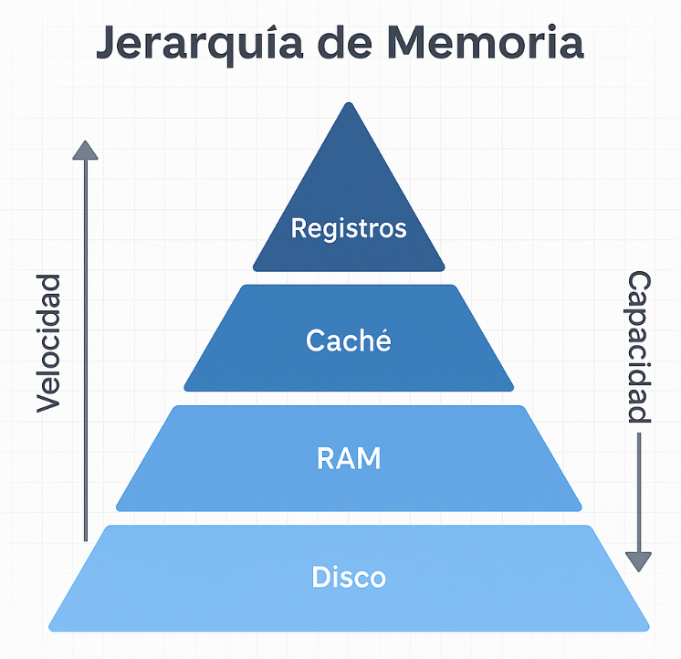
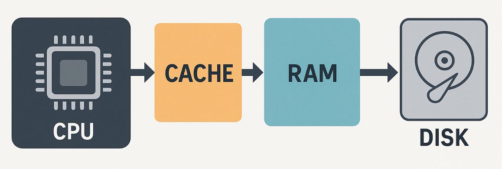
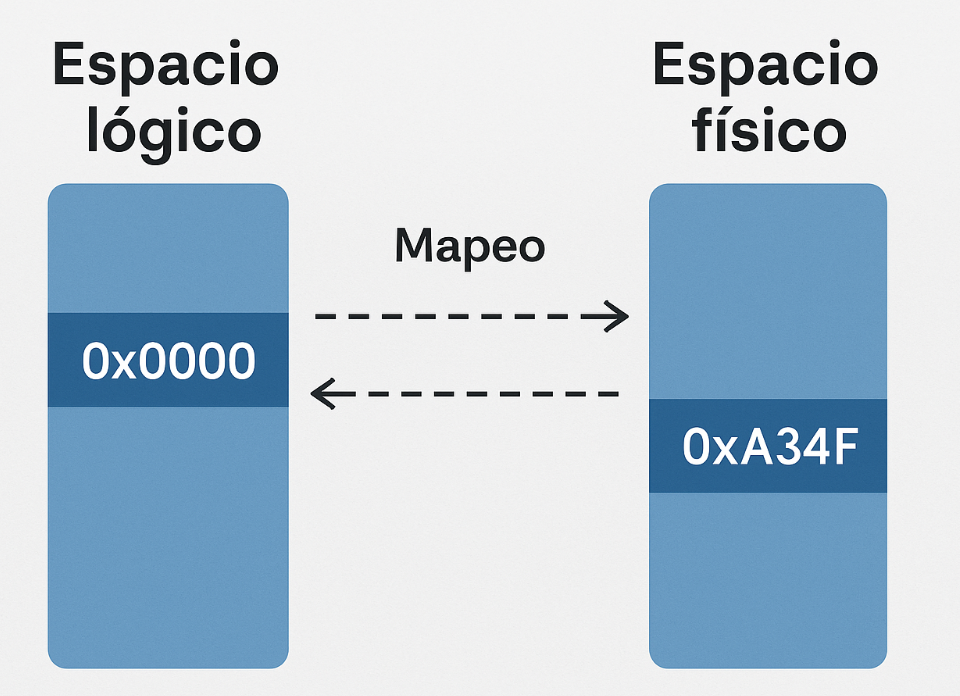
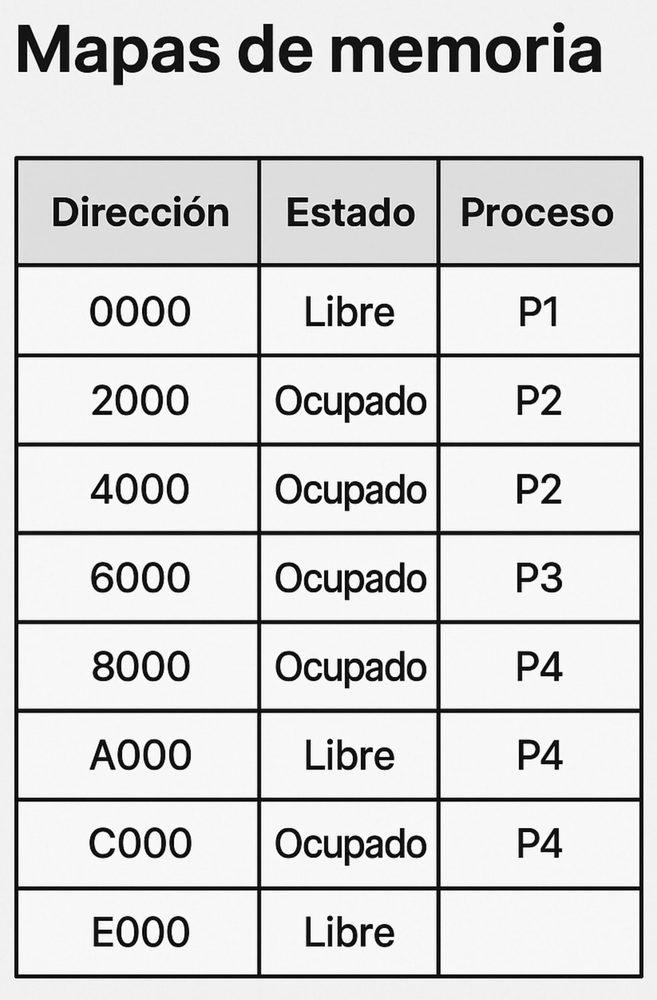
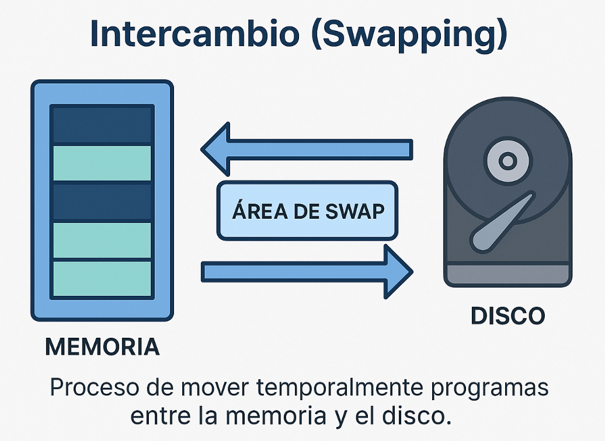
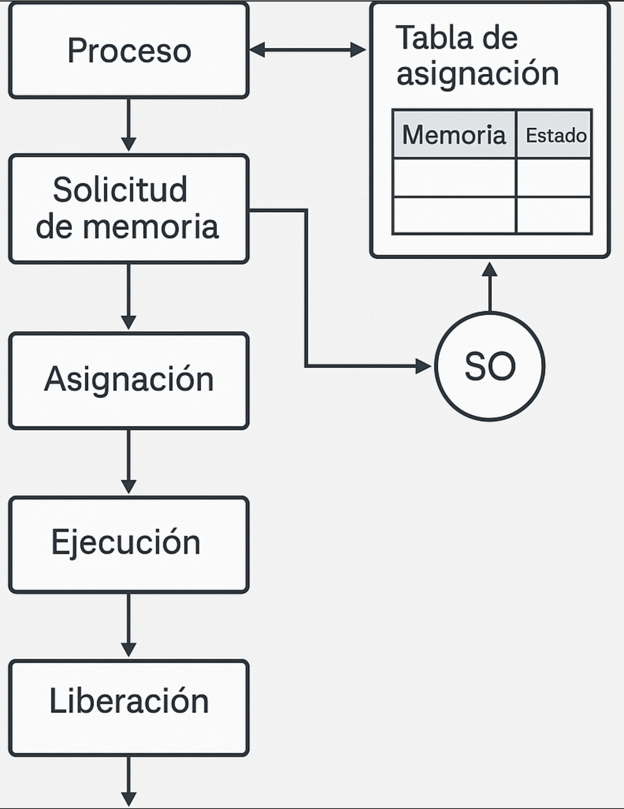
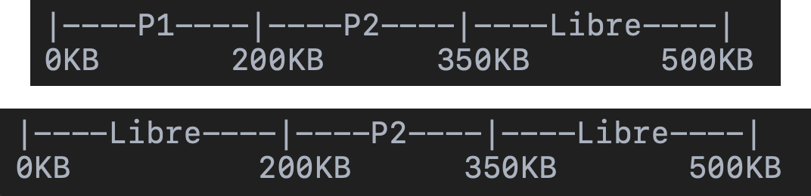

# Capítulo 14. Administración de memoria en ejecución

## Del mapa de memoria a las decisiones del Sistema Operativo

En el capítulo anterior estudiamos **particiones, fragmentación, algoritmos de ajuste y paginación**. Comprendimos cómo puede organizarse la memoria y cómo una dirección lógica puede terminar asociada con una ubicación física.

Ahora cambiaremos ligeramente la pregunta:

> **Mientras los procesos están ejecutándose, ¿qué decisiones debe tomar continuamente el Sistema Operativo para administrar la memoria?**

La respuesta involucra asignación, protección, liberación, traducción de direcciones, intercambio con disco, jerarquía de memoria y políticas de reemplazo.

::: {.callout-tip title="Idea central"}
La administración de memoria no ocurre una sola vez cuando se inicia un programa. Es un **proceso continuo** durante toda la vida de los procesos.
:::

---

# Objetivos de aprendizaje

Al finalizar este capítulo, el estudiante será capaz de:

- Explicar la función del administrador de memoria del Sistema Operativo.
- Interpretar la **jerarquía de memoria** y su relación velocidad-capacidad-costo.
- Relacionar direcciones lógicas y físicas con protección de memoria.
- Explicar el uso conceptual de registros **base y límite**.
- Interpretar un **mapa de memoria**.
- Comprender el intercambio o **swapping** entre RAM y almacenamiento secundario.
- Explicar por qué la compactación puede reducir fragmentación externa y cuál es su costo.
- Relacionar caché, RAM y almacenamiento dentro de la jerarquía.
- Introducir el propósito de las políticas de reemplazo, especialmente **LRU**.
- Integrar estos mecanismos dentro del ciclo solicitud → asignación → ejecución → liberación.

---

# 1. ¿Qué administra realmente el Sistema Operativo?

La memoria principal es el espacio de trabajo inmediato de los procesos. Mientras varios programas compiten por RAM, el Sistema Operativo debe mantener control sobre cinco tareas esenciales:

1. **Seguimiento:** saber qué zonas están ocupadas y cuáles libres.
2. **Asignación:** decidir dónde colocar la memoria solicitada por un proceso.
3. **Protección:** impedir que un proceso acceda indebidamente a otro.
4. **Intercambio:** mover temporalmente información entre RAM y almacenamiento cuando sea necesario.
5. **Liberación:** recuperar el espacio cuando deja de utilizarse.

```{mermaid}
%%| fig-width: 7.4
%%| fig-height: 4.4
%%| fig-align: center
flowchart LR
    P[Proceso] --> S[Solicita memoria]
    S --> SO[Administrador de memoria]
    SO --> A[Asignar]
    SO --> PR[Proteger]
    SO --> SE[Supervisar]
    A --> RAM[RAM]
    PR --> RAM
    SE --> RAM
    RAM --> L[Liberar]
    L --> SO
```

::: {.callout-note title="Conexión con lo que ya sabemos"}
Las particiones y la paginación estudiadas anteriormente son **mecanismos de organización**. En esta clase observaremos el trabajo operativo que existe alrededor de ellos.
:::

---

# 2. La jerarquía de memoria

No toda la memoria de una computadora tiene la misma velocidad, capacidad ni costo.

En términos generales:

| Nivel | Componente | Velocidad relativa | Capacidad relativa | Cercanía al CPU |
|---|---|---|---|---|
| 1 | Registros | Muy alta | Muy baja | Máxima |
| 2 | Caché L1/L2/L3 | Alta | Baja | Muy cercana |
| 3 | RAM | Media | Media | Intermedia |
| 4 | SSD / almacenamiento | Mucho menor | Alta | Más lejana |

{fig-align="center" width="72%" fig-alt="Diapositiva base sobre jerarquía de memoria"}

::: {.callout-important title="Una relación que conviene recordar"}
Al acercarnos al CPU normalmente obtenemos **más velocidad y menos capacidad**. Al alejarnos obtenemos **más capacidad, pero mayor latencia**.
:::

## Una analogía sencilla

Pensemos en un estudiante resolviendo un ejercicio:

```text
Dato que tiene en la mente       → Registro
Dato escrito en una hoja cercana → Caché
Libro abierto sobre el escritorio→ RAM
Libro guardado en la biblioteca  → Almacenamiento
```

Mientras más lejos esté la información, más tiempo necesitamos para obtenerla.

---

# 3. ¿Por qué existe la caché?

El CPU puede trabajar mucho más rápido que la RAM. Si tuviera que esperar continuamente por cada dato, una parte importante de su capacidad se desperdiciaría.

La **memoria caché** mantiene cerca del procesador datos e instrucciones que probablemente serán utilizados nuevamente.

{fig-align="center" width="68%" fig-alt="Relación conceptual entre CPU, caché, RAM y disco"}

Podemos resumir la idea:

```text
CPU necesita un dato
       ↓
¿Está en caché?
   ↓ Sí       ↓ No
 usarlo      buscarlo en un nivel inferior
```

::: {.callout-note title="No confundamos funciones"}
La caché **no sustituye a la RAM** y la RAM no sustituye al almacenamiento. Los niveles trabajan juntos para equilibrar velocidad, capacidad y costo.
:::

---

# 4. Dirección lógica y dirección física: retomemos el concepto

En el capítulo anterior distinguimos:

- **dirección lógica:** la dirección utilizada dentro del espacio del proceso;
- **dirección física:** la ubicación real correspondiente en RAM.

{fig-align="center" width="70%" fig-alt="Diagrama conceptual de espacio lógico y espacio físico"}

La separación permite que un proceso no necesite conocer la ubicación física exacta donde fue colocado.

```{mermaid}
%%| fig-width: 7
%%| fig-height: 3.5
%%| fig-align: center
flowchart LR
    CPU[CPU / Proceso] -->|Dirección lógica| MMU[MMU<br/>traducción y validación]
    MMU -->|Dirección física| RAM[RAM]
```

La **MMU (Memory Management Unit)** participa en la traducción y comprobación de direcciones utilizando la información configurada por el Sistema Operativo.

---

# 5. Protección de memoria

Imaginemos dos procesos:

```text
Proceso A → navegador
Proceso B → sistema de notas
```

¿Qué ocurriría si el navegador pudiera escribir libremente sobre la memoria del sistema de notas?

Podría:

- alterar datos;
- provocar errores;
- comprometer información;
- hacer fallar otros procesos o el sistema.

Por ello el Sistema Operativo y el hardware aplican mecanismos de protección.

Entre los conceptos fundamentales encontramos:

- permisos de lectura;
- permisos de escritura;
- permisos de ejecución;
- límites de regiones válidas;
- excepciones cuando se intenta un acceso indebido.

::: {.callout-warning title="Idea fundamental"}
La administración de memoria no busca solamente **aprovechar espacio**. También debe garantizar **aislamiento y protección entre procesos**.
:::

---

# 6. Registro base y límite

Un modelo didáctico clásico para comprender protección y reubicación utiliza dos valores:

- **Base:** inicio del espacio físico asignado.
- **Límite:** tamaño máximo permitido para el proceso.

Supongamos:

```text
Proceso A
Base   = 1000
Límite = 2000
```

El proceso dispone conceptualmente de desplazamientos desde `0` hasta `1999`.

Si solicita:

```text
Dirección lógica = 500
```

podemos representar:

```text
Dirección física = Base + desplazamiento
                  = 1000 + 500
                  = 1500
```

Pero antes debemos comprobar:

```text
¿500 < 2000?
```

Sí. El acceso se encuentra dentro del límite.

## ¿Y si solicita 2300?

```text
2300 < 2000 → FALSO
```

El acceso debe rechazarse.

```{mermaid}
%%| fig-width: 7
%%| fig-height: 4
%%| fig-align: center
flowchart LR
    D[Dirección lógica] --> C{¿dirección < límite?}
    C -->|Sí| S[Base + dirección]
    S --> F[Dirección física]
    C -->|No| E[Excepción<br/>acceso inválido]
```

::: {.callout-tip title="Pregunta para el grupo"}
Si `Base = 4000`, `Límite = 1500` y el proceso solicita la dirección lógica `1200`, ¿cuál sería la dirección física? ¿El acceso es válido?
:::

---

# 7. Mapas de memoria: la fotografía de la RAM

Para administrar un recurso necesitamos saber qué parte se encuentra disponible.

Un **mapa de memoria** representa regiones ocupadas y libres, y puede asociarlas con procesos.

{fig-align="center" width="67%" fig-alt="Ejemplo de mapa de memoria con direcciones, estado y proceso"}

Una representación simplificada podría ser:

| Inicio | Fin | Estado | Proceso |
|---:|---:|---|---|
| 0 | 199 | Ocupado | P1 |
| 200 | 349 | Libre | — |
| 350 | 599 | Ocupado | P2 |
| 600 | 799 | Libre | — |

Este mapa permite responder preguntas como:

- ¿cuánta memoria queda libre?;
- ¿dónde existe un bloque disponible?;
- ¿qué proceso ocupa determinada región?;
- ¿qué ocurre cuando un proceso finaliza?;

---

# 8. Liberación: la memoria debe regresar al sistema

Asignar memoria es solamente la mitad del trabajo.

Cuando un proceso termina o deja de necesitar una región, el Sistema Operativo debe marcar ese espacio como disponible.

```text
ANTES
0        200        350        600
|---P1---|---P2------|---Libre---|

P1 termina

DESPUÉS
0        200        350        600
|--Libre-|---P2------|---Libre---|
```

Ahora aparecen varios espacios libres separados.

Esto nos conecta con la **fragmentación externa** estudiada en el capítulo anterior.

---

# 9. Compactación: reunir espacios libres

Cuando existen huecos libres dispersos, una estrategia conceptual consiste en mover procesos para reunir esos espacios.

```text
ANTES
[P1][Libre][P2][Libre][P3][Libre]

DESPUÉS
[P1][P2][P3][---------Libre-----]
```

A esto lo llamamos **compactación**.

::: {.callout-warning title="La compactación no es gratuita"}
Mover procesos o regiones de memoria implica trabajo adicional. Por ello la compactación ayuda a comprender el problema de la fragmentación externa, pero tiene un **costo de tiempo y movimiento de datos**.
:::

---

# 10. ¿Qué ocurre cuando la RAM no alcanza?

Supongamos que la RAM está bajo presión y necesitamos liberar espacio para continuar ejecutando procesos.

Una estrategia histórica y conceptual es el **swapping** o intercambio.

{fig-align="center" width="70%" fig-alt="Diagrama conceptual de swapping entre memoria y disco"}

El principio es:

```text
RAM llena
   ↓
seleccionar información/proceso que puede salir temporalmente
   ↓
mover al almacenamiento
   ↓
liberar RAM
   ↓
cuando vuelva a necesitarse
   ↓
recuperar información
```

::: {.callout-important title="Costo del intercambio"}
El almacenamiento secundario es mucho más lento que la RAM. Por eso intercambiar continuamente información puede degradar notablemente el rendimiento.
:::

---

# 11. Swapping y paginación: no son exactamente lo mismo

Conviene diferenciar dos ideas.

| Concepto | Idea principal |
|---|---|
| **Swapping clásico** | Mover temporalmente grandes regiones o procesos entre RAM y almacenamiento |
| **Paginación / memoria virtual** | Gestionar la memoria en páginas y permitir que determinadas páginas no estén actualmente en RAM |

En sistemas modernos, la gestión de memoria virtual basada en páginas permite trabajar con una granularidad mucho más fina que el intercambio clásico de un proceso completo.

::: {.callout-note title="Conexión"}
Esto explica por qué la paginación estudiada anteriormente es tan importante: prepara el camino para administrar qué páginas permanecen en RAM y cuáles pueden obtenerse desde almacenamiento cuando se necesiten.
:::

---

# 12. Administración durante la ejecución

Podemos representar el ciclo general de memoria así:

{fig-align="center" width="67%" fig-alt="Flujo conceptual de solicitud, asignación, ejecución y liberación de memoria"}

```text
Proceso
   ↓
Solicitud de memoria
   ↓
¿Existe espacio / marco disponible?
   ↓
Asignación
   ↓
Protección y registro
   ↓
Ejecución
   ↓
Liberación
   ↓
Memoria disponible nuevamente
```

El Sistema Operativo debe repetir estas decisiones para muchos procesos durante toda la ejecución del sistema.

---

# 13. Cuando necesitamos una página que no está en RAM

La memoria virtual introduce una situación nueva:

> El proceso intenta utilizar una página válida, pero esa página no se encuentra actualmente cargada en RAM.

Conceptualmente ocurre un **fallo de página (page fault)**.

El flujo simplificado es:

```{mermaid}
%%| fig-width: 7.4
%%| fig-height: 5.2
%%| fig-align: center
flowchart TD
    A[Proceso referencia una página] --> B{¿Está en RAM?}
    B -->|Sí| C[Acceder al marco]
    B -->|No| D[Page fault]
    D --> E[Localizar página en almacenamiento]
    E --> F{¿Hay marco libre?}
    F -->|Sí| G[Cargar página]
    F -->|No| H[Seleccionar una página para reemplazar]
    H --> G
    G --> I[Actualizar tabla de páginas]
    I --> C
```

Ahora aparece otra pregunta:

> **Si no existe un marco libre, ¿qué página deberíamos retirar?**

---

# 14. Introducción a los algoritmos de reemplazo

Cuando es necesario liberar un marco, el Sistema Operativo necesita una **política de reemplazo**.

Existen diferentes estrategias. En esta clase introduciremos una de las más conocidas conceptualmente: **LRU (Least Recently Used)**.

LRU intenta reemplazar la página cuyo uso más reciente ocurrió hace más tiempo.

Podemos expresarlo como:

> “Si una página no se ha utilizado recientemente, puede ser una candidata para salir de RAM”.

Supongamos que el orden de uso reciente es:

```text
Más antiguo                  Más reciente
Página 2 → Página 5 → Página 1 → Página 3
```

Si necesitamos seleccionar una candidata según LRU:

```text
Página 2
```

::: {.callout-note title="Importante"}
LRU es una **política de reemplazo de páginas**, no un algoritmo de asignación de particiones como First Fit, Best Fit o Worst Fit.
:::

---

# 15. Caso integrador: 1024 KB de RAM

Analicemos un caso similar al material de clase, pero ajustado para que la memoria inicial sea válida.

Tenemos:

```text
RAM total = 1024 KB

P1 = 200 KB
P2 = 250 KB
P3 = 300 KB
```

## Paso 1. Memoria utilizada

```text
200 + 250 + 300 = 750 KB
```

## Paso 2. Memoria libre

```text
1024 - 750 = 274 KB
```

Ahora llega:

```text
P4 = 300 KB
```

Preguntas:

1. ¿Cabe P4 directamente en los 274 KB libres?
2. ¿Qué alternativas podría considerar el Sistema Operativo?
3. ¿Cambiaría el análisis si utilizamos memoria virtual y paginación?

::: {.callout-tip collapse="true" title="✅ Analicemos"}
P4 necesita **300 KB**, pero solamente existen **274 KB** disponibles en RAM.

Por tanto, no cabe completamente en la memoria libre disponible bajo un modelo simple de asignación contigua.

Dependiendo del mecanismo utilizado, el sistema podría necesitar liberar memoria, intercambiar información con almacenamiento o, en un esquema de memoria virtual, administrar las páginas necesarias sin exigir que todo el proceso se encuentre simultáneamente en RAM.
:::

::: {.callout-warning title="Ajuste didáctico respecto al PPT"}
En el caso original de la presentación aparecen `P1 = 200 KB`, `P2 = 350 KB` y `P3 = 500 KB` dentro de una RAM de `1024 KB`. Esos tres procesos suman **1050 KB**, por lo que ya exceden la RAM antes de que llegue P4. Para este capítulo ajustamos los valores y conservamos la intención del ejercicio: analizar qué ocurre cuando llega un proceso que ya no cabe en la memoria disponible.
:::

---

# 16. Simulemos un mapa de memoria

La presentación propone como repaso un administrador sencillo capaz de:

- asignar bloques;
- liberar espacios;
- mostrar el mapa de memoria.

{fig-align="center" width="72%" fig-alt="Ejemplo de simulación de asignación y liberación de memoria"}

Antes de programar algo así, deberíamos poder representar manualmente:

```text
[ P1 ][   P2   ][ Libre ]
```

Luego liberar P1:

```text
[Libre][   P2   ][ Libre ]
```

Y finalmente decidir qué hacer cuando llegue otro proceso.

::: {.callout-tip title="Conexión con el proyecto integrador"}
Este modelo es una buena base para el componente de **Administración de Memoria** del simulador del curso: primero comprender el mapa y las decisiones; después representarlas mediante código.
:::

---

# 17. Sistemas reales: una precisión importante

La presentación utiliza Windows y Linux para ejemplificar memoria virtual, paginación y espacio de intercambio. La idea general es correcta: ambos sistemas modernos utilizan **memoria virtual** y mecanismos de paginación.

Para mantener el modelo conceptual actualizado, conviene evitar interpretar que Linux moderno administra normalmente la memoria de usuario mediante **segmentación en lugar de paginación**. En arquitecturas actuales como x86-64, la paginación es el mecanismo fundamental de traducción y protección de memoria virtual; el uso de segmentación es mucho más limitado.

Podemos conservar esta comparación conceptual:

| Aspecto | Windows | Linux |
|---|---|---|
| Memoria virtual | Sí | Sí |
| Paginación | Sí | Sí |
| Respaldo en almacenamiento | Archivo de paginación | Área o archivo swap |
| Protección por proceso | Sí | Sí |

---

# 18. Caso de análisis final

Tenemos una memoria representada así:

```text
0 KB                                          1000 KB
|----P1----|--Libre--|------P2------|---Libre---|
    200       150          400          250
```

Llega:

```text
P3 = 300 KB
```

Analiza:

1. ¿Cuánta memoria libre existe en total?
2. ¿Existe un bloque contiguo de 300 KB?
3. ¿Qué problema aparece?
4. ¿Serviría la compactación?
5. ¿Qué ventaja ofrecería un esquema paginado?
6. Si una página necesaria no estuviera en RAM, ¿qué evento podría producirse?
7. Si no hubiera marcos libres, ¿qué tipo de algoritmo necesitaríamos?

::: {.callout-tip collapse="true" title="✅ Solución propuesta"}
Existe:

```text
150 + 250 = 400 KB libres
```

pero el bloque libre más grande es de `250 KB`.

Por tanto, P3 no cabe como bloque contiguo de `300 KB`, aunque existe suficiente memoria libre **en total**. Esto representa **fragmentación externa**.

La compactación podría reunir los espacios libres, aunque implica costo de movimiento. Un esquema paginado permitiría colocar las páginas en marcos no contiguos. Si una página válida no estuviera cargada, se produciría un **page fault**. Si no hubiera marcos libres, sería necesaria una política de **reemplazo de páginas**.
:::

---

# 19. Autoevaluación

1. ¿Cuáles son las cinco funciones principales del administrador de memoria?
2. ¿Por qué la memoria se organiza jerárquicamente?
3. ¿Qué diferencia existe entre RAM y caché?
4. ¿Qué diferencia existe entre dirección lógica y física?
5. ¿Qué función cumple conceptualmente la MMU?
6. ¿Qué representan los registros base y límite?
7. ¿Por qué la protección de memoria es necesaria?
8. ¿Qué información puede mostrar un mapa de memoria?
9. ¿Qué significa liberar memoria?
10. ¿Qué problema intenta resolver la compactación?
11. ¿Qué es swapping?
12. ¿Por qué demasiado intercambio reduce el rendimiento?
13. ¿Qué es un page fault?
14. ¿Cuándo necesitamos un algoritmo de reemplazo de páginas?
15. ¿Cuál es la idea fundamental de LRU?
16. ¿Qué relación existe entre paginación y memoria virtual?

---

# 20. Para recordar

```text
CPU NECESITA DATOS
      ↓
JERARQUÍA DE MEMORIA
      ↓
CACHÉ → RAM → ALMACENAMIENTO
      ↓
PROCESO SOLICITA MEMORIA
      ↓
ASIGNAR + REGISTRAR + PROTEGER
      ↓
DIRECCIÓN LÓGICA → TRADUCCIÓN → FÍSICA
      ↓
EJECUCIÓN
      ↓
LIBERAR MEMORIA
      ↓
SI FALTA RAM
      ↓
MEMORIA VIRTUAL / INTERCAMBIO
      ↓
PAGE FAULT
      ↓
¿HAY MARCO LIBRE?
      ↓ NO
REEMPLAZO DE PÁGINAS (ej. LRU)
```

::: {.callout-success title="Idea de cierre"}
Administrar memoria significa mucho más que encontrar un espacio libre. El Sistema Operativo debe **saber dónde están los datos, protegerlos, traducir direcciones, mover información entre niveles y recuperar el espacio cuando deja de utilizarse**.
:::

---

# Conexión con la siguiente clase

Ya conocemos las estructuras de organización de memoria y el ciclo operativo de asignación, protección, liberación e intercambio.

El siguiente paso natural es profundizar en **memoria virtual y algoritmos de reemplazo de páginas**, comparando cómo diferentes políticas deciden qué información debe permanecer en RAM cuando la memoria física es insuficiente.

---

# Referencias

Material base de clase:

- Presentación **Administración de Memoria**, Sistemas Operativos I.
- Capítulo anterior del libro: **Manejo de memoria: particiones y paginación**.

::: {.callout-note title="Criterio editorial"}
Este capítulo reorganiza la presentación para evitar repetir en profundidad particiones y paginación, ya desarrolladas en el capítulo anterior. Se conservaron como eje las ideas de **jerarquía, protección, mapas de memoria, swapping, administración en ejecución y LRU**, y se corrigieron explícitamente dos simplificaciones del material original para mantener consistencia técnica.
:::
