::: {.callout-tip title="La pregunta que une todo el semestre"}
**Cuando abrimos una página PHP que consulta MySQL, mientras Oracle se ejecuta en otro contenedor, ¿qué está haciendo realmente el sistema operativo?**
:::

## Propósito de la clase

Esta clase **no instala otro programa**: conecta lo aprendido sobre **procesos, PCB, estados, planificación, concurrencia, multiprogramación, memoria, kernel, interbloqueos, servicios, redes y persistencia** con el entorno que ya construimos en las clases 22–26. El próximo encuentro será el laboratorio del proyecto final.

**Duración sugerida:** 90 minutos. **Requisitos:** haber trabajado las clases de Docker, Linux y kernel, Apache/MySQL, CRUD PHP y Oracle. Los comandos de observación son opcionales; no requieren modificar datos.

**Al finalizar**, el estudiante podrá explicar qué ocurre desde que un navegador solicita una página hasta que la base de datos responde; identificar procesos y estados; distinguir concurrencia de paralelismo; interpretar recursos compartidos; y justificar decisiones básicas de aislamiento y persistencia.

## Nuestro escenario: una computadora, varios servicios

En los laboratorios previos utilizamos Docker, un Linux de prácticas, Apache/PHP, MySQL y Oracle. Este diagrama es **conceptual**: los nombres de los contenedores pueden variar según el equipo. En macOS y Windows, Docker Desktop utiliza un entorno Linux virtualizado; los contenedores comparten **el kernel Linux de ese entorno**, no directamente el kernel de macOS o Windows.

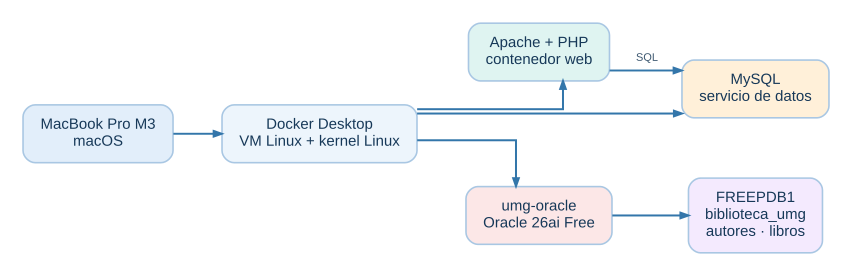{fig-align="center" width="95%"}

::: {.callout-note title="No confundir tres niveles"}
**Contenedor Docker:** `umg-oracle`. **Base conectable Oracle (PDB):** `FREEPDB1`. **Esquema/usuario:** `biblioteca_umg`, propietario de `autores` y `libros`. `CDB$ROOT` es el contenedor raíz **de Oracle**, no un contenedor Docker.
:::

**Pregunta de apertura (3 minutos):** ¿Cuántos sistemas operativos hay aquí? ¿Dónde se ejecuta el kernel? ¿Por qué el navegador puede acceder al servicio sin entrar al contenedor?

## Un clic se convierte en procesos

Imaginemos que el estudiante solicita una página de la biblioteca que consulta libros. Una petición de red activa trabajo en varios procesos, que el kernel planifica y coordina. El siguiente flujo es **simplificado**: no representa todos los hilos ni las operaciones internas de Apache, PHP o MySQL.

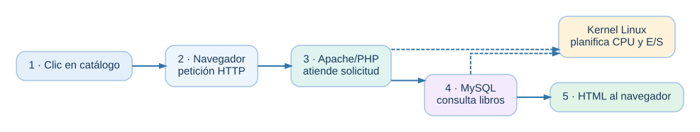{fig-align="center" width="95%"}

**Interpretación:** Apache y MySQL son servicios distintos. Sus procesos pueden alternarse en CPU, bloquearse esperando E/S y volver a estar listos. El navegador corre en el anfitrión; los procesos del servidor y la base de datos corren dentro del entorno Linux de Docker.

## Procesos y PCB: la ficha que permite continuar

Un **proceso** es un programa en ejecución, con contexto y recursos. El **bloque de control de proceso (PCB)** es una estructura conceptual del sistema operativo que conserva información para administrarlo: identificador, estado, registros/contexto de CPU, información de planificación, memoria y recursos abiertos. En Linux, estas responsabilidades se representan en estructuras del kernel; **no existe necesariamente una tabla visible llamada literalmente PCB**.

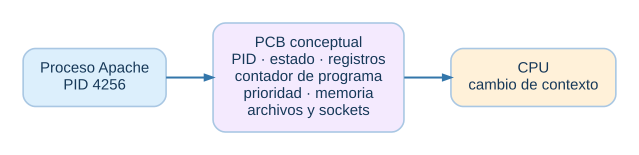{fig-align="center" width="95%"}

**Ejemplo guiado:** Apache estaba atendiendo una petición; necesita esperar una respuesta de MySQL. El kernel puede dejar de ejecutarlo y dar CPU a otro proceso. Cuando la respuesta está disponible, Apache vuelve a estar listo para continuar. **El PCB permite conservar y recuperar su contexto.**

**Observación opcional desde la terminal del anfitrión:**

```bash
# Ejecutar cada línea por separado; no son instrucciones SQL.
docker ps
```

```bash
docker top umg-oracle
```

`docker top` muestra procesos del contenedor. **No muestra directamente el PCB completo**. El nombre `umg-oracle` corresponde al laboratorio validado; para otros servicios usar el nombre real indicado por `docker ps`.

### Ficha didáctica de un PCB (ejemplo conceptual)

| Campo del PCB | ¿Qué representa? | Ejemplo ilustrativo |
|:--|:--|:--|
| PID | Identificador del proceso | `4256` |
| Estado | Situación actual del proceso | Listo / ejecución / bloqueado |
| Contador de programa | Próxima instrucción a ejecutar | Dirección de memoria |
| Registros de CPU | Contexto que se conserva al interrumpir | Registros y punteros |
| Planificación | Prioridad y datos para decidir turnos | Prioridad / política |
| Memoria | Información del espacio de direcciones | Páginas y mapas |
| E/S y archivos | Recursos abiertos por el proceso | Socket HTTP / archivos |

**Nota:** los valores son ejemplos; el PCB real depende del sistema operativo y su implementación.

## Estados de un proceso: del navegador a la base de datos

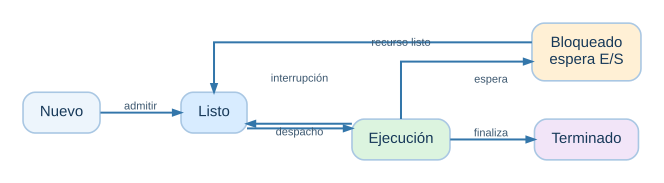{fig-align="center" width="95%"}

| Estado | Ejemplo del laboratorio | ¿Usa CPU en ese instante? |
|---|---|---|
| Nuevo | Se inicia un proceso del servicio | Todavía no necesariamente |
| Listo | Puede ejecutarse, espera turno | No |
| Ejecución | Atiende la petición o procesa SQL | Sí, en un núcleo |
| Bloqueado / espera | Espera red, disco o respuesta | Normalmente no |
| Terminado | El proceso concluye | No |

**Discusión:** ¿Un proceso que espera al disco está «fallando»? No: esperar es parte normal de la ejecución.

## Planificación, concurrencia y multiprogramación

**Multiprogramación:** varios programas/procesos residen en memoria y el sistema alterna su ejecución para aprovechar la CPU cuando alguno espera. **Concurrencia:** varias actividades progresan durante un intervalo, aunque no estén ejecutándose exactamente al mismo tiempo. **Paralelismo:** dos o más actividades se ejecutan simultáneamente en diferentes núcleos o unidades de ejecución.

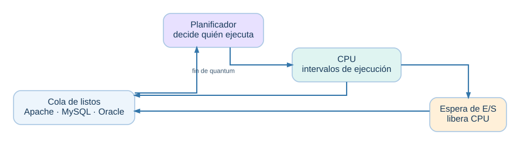{fig-align="center" width="95%"}

*Diagrama ilustrativo: los intervalos no son mediciones reales ni representan el algoritmo exacto del planificador.*

**Preguntas:** Si Apache espera una consulta, ¿por qué Oracle puede avanzar? Si el equipo tiene varios núcleos, ¿qué cambia? ¿Por qué tener tres contenedores no significa tener tres CPU?

## Memoria, aislamiento y límites

Cada proceso tiene un espacio de direcciones virtuales; el kernel administra memoria, páginas y permisos. Los contenedores **no reciben un kernel propio**: Linux utiliza mecanismos como **namespaces** (aislamiento de vistas de recursos) y **cgroups** (contabilidad y límites de recursos). Un contenedor no equivale a una máquina virtual completa.

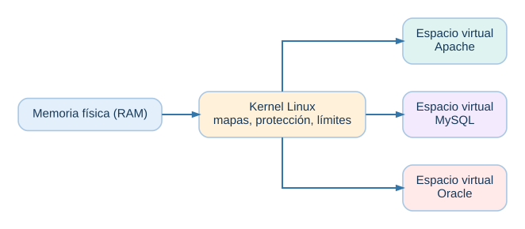{fig-align="center" width="95%"}

**Observación segura:**

```bash
docker stats --no-stream
```

Este comando permite comparar consumo observado de CPU y memoria de contenedores. **No es un medidor del PCB ni de la memoria física exacta de cada proceso.**

**Caso para debatir:** Si Oracle consume mucha RAM, ¿por qué Apache podría responder más lentamente? Considerar competencia por memoria, CPU y E/S, y límites configurados.

## Concurrencia, sincronización e interbloqueos

Cuando varios procesos acceden a datos compartidos, el resultado puede depender del orden de ejecución. Las bases de datos utilizan mecanismos de concurrencia y transacciones para preservar consistencia; no basta con «tener varios contenedores» para evitar conflictos.

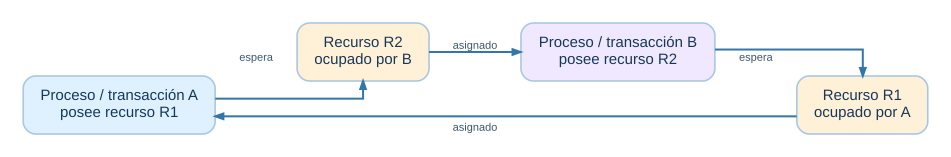{fig-align="center" width="95%"}

**Interbloqueo (*deadlock*):** A retiene un recurso y espera otro; B retiene el segundo y espera el primero. Si ninguna puede continuar, hay espera circular. El gestor de base de datos puede detectar un interbloqueo y cancelar una operación; **no implica que Docker haya fallado**.

**Pregunta de razonamiento:** ¿Qué diferencia hay entre una espera normal de disco y un interbloqueo? ¿Qué orden común de adquisición de recursos ayudaría a prevenirlo?

## Procesos, servicios, puertos y comunicación

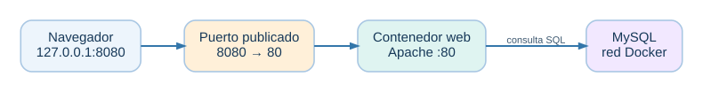{fig-align="center" width="95%"}


Un **proceso** ejecuta instrucciones. Un **servicio** ofrece una función disponible para otros programas; puede involucrar uno o varios procesos. Un **puerto** identifica un punto de comunicación de red, no un proceso por sí mismo.

| Elemento | En nuestras clases | Concepto de SO |
|---|---|---|
| Apache/PHP | Atiende peticiones web | Servicio, procesos, sockets |
| MySQL | Responde consultas | Procesos, E/S, concurrencia |
| Oracle | Listener en puerto 1521 | Servicio de red y administración de procesos |
| `127.0.0.1:8080` | Acceso a la web desde el anfitrión | Publicación/redirección de puerto |
| `127.0.0.1:1521` | Acceso a Oracle desde el anfitrión | Publicación/redirección de puerto |

**Pregunta:** ¿Qué sucede si dos contenedores intentan publicar el mismo puerto `127.0.0.1:1521` del anfitrión? El segundo no podrá reservar esa misma combinación de dirección y puerto mientras esté ocupada, aunque ambos servicios usen internamente el puerto 1521.

## Persistencia: detener no es borrar

El contenedor tiene un ciclo de vida; los datos importantes deben persistir fuera de su capa escribible efímera. En Oracle utilizamos el volumen `oracle_datos_umg`.

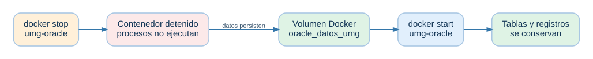{fig-align="center" width="95%"}

**Precisión:** detener (`stop`) conserva el contenedor y su capa escribible; eliminar (`rm`) elimina esa capa, pero un volumen nombrado puede permanecer. Para recuperar los datos en otro contenedor, se debe montar **el mismo volumen** y mantener compatibilidad con la aplicación.

## Mapa integrador: ¿dónde aparece cada concepto?

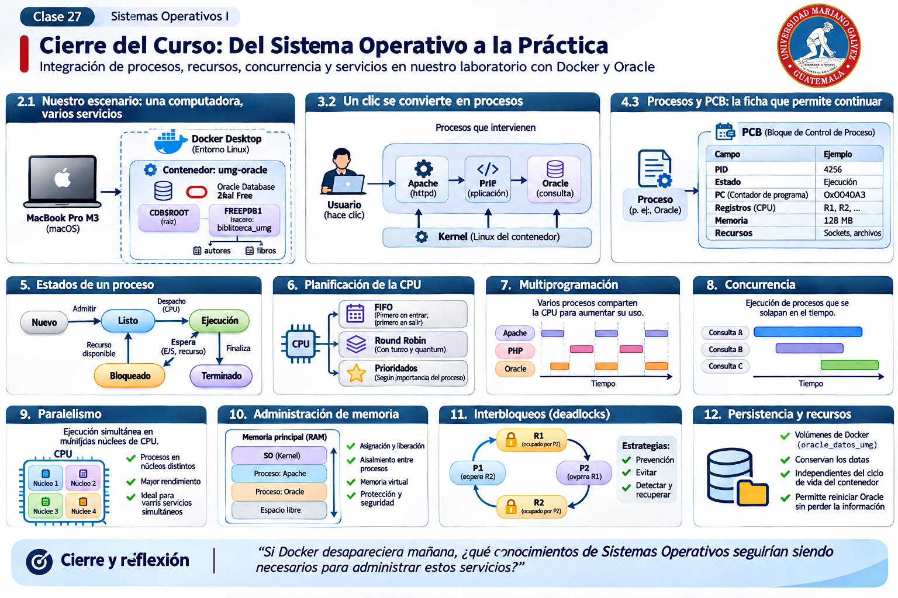{fig-align="center" width="100%"}

{fig-align="center" width="95%"}


| Concepto del semestre | Evidencia en el proyecto | Pregunta que debe poder responder el estudiante |
|---|---|---|
| Kernel | Contenedores comparten kernel Linux | ¿Quién administra realmente la CPU? |
| Proceso y PCB | Apache, MySQL, Oracle | ¿Qué guarda el SO al suspender un proceso? |
| Estados | Espera de red/disco/consulta | ¿Cuándo pasa de bloqueado a listo? |
| Planificación | Procesos compiten por CPU | ¿Qué sucede cuando hay más procesos que núcleos? |
| Multiprogramación | Servicios simultáneamente activos | ¿Por qué una espera no detiene a todos? |
| Concurrencia | Varias peticiones y transacciones | ¿Cuándo hay condiciones de carrera? |
| Interbloqueos | Bloqueos cruzados de transacciones | ¿Qué es una espera circular? |
| Memoria | `docker stats` | ¿Qué controla el kernel y qué limitan los cgroups? |
| Archivos y E/S | Datos de las bases | ¿Qué cambia al usar un volumen? |
| Redes | Puertos y sockets | ¿Qué significa `8080:80`? |
| Aislamiento | Namespaces y contenedores | ¿Por qué no es una VM completa? |

## Actividad de cierre: «Soy el sistema operativo» (20 minutos)

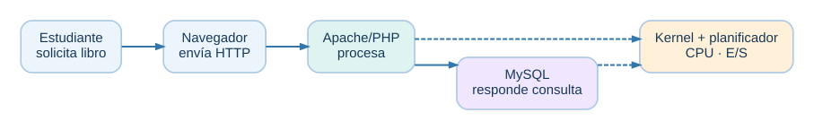{fig-align="center" width="95%"}


**Organización:** equipos de 4–5 estudiantes. Asignar roles: navegador, Apache/PHP, kernel/planificador, MySQL y observador (si hay cuatro, el observador puede ser el docente).

**Situación:** llegan dos solicitudes de catálogo casi al mismo tiempo. MySQL debe leer datos y Oracle sigue ejecutándose en segundo plano.

1. El navegador solicita el catálogo; Apache pasa a ejecución.
2. Apache envía una consulta y queda esperando una respuesta.
3. El planificador entrega CPU a otro proceso listo.
4. MySQL procesa la consulta y solicita E/S.
5. Al completarse la E/S, MySQL queda listo y luego ejecuta.
6. Apache recibe la respuesta y entrega HTML al navegador.

**Producto del equipo:** dibujar el recorrido de una solicitud, identificar **dos cambios de estado**, explicar **un cambio de contexto**, distinguir **concurrencia y paralelismo**, y señalar **qué información debe sobrevivir al reinicio del contenedor**.

::: {.callout-important title="La pregunta de oro"}
**Si el sistema funciona, ¿qué parte de ese funcionamiento depende de la aplicación, qué parte depende de Docker y qué parte depende del kernel?** Responder con un ejemplo concreto de cada una.
:::

## Comprobación individual (10 minutos)

1. ¿Por qué el PCB es necesario si hay varios procesos listos?
2. ¿Qué estado tiene un proceso que espera una respuesta de red?
3. ¿Concurrencia y paralelismo significan lo mismo? Justifique.
4. ¿Por qué los contenedores comparten kernel Linux, pero no necesariamente los mismos procesos visibles?
5. ¿Qué recurso se conserva en `oracle_datos_umg` al detener `umg-oracle`?
6. ¿Qué riesgo existe cuando dos transacciones adquieren bloqueos en órdenes diferentes?

::: {.callout-note title="Orientaciones para el docente"}
**Respuestas clave:** (1) conservar contexto y datos de planificación; (2) bloqueado/espera hasta evento, luego listo; (3) no, progreso intercalado frente a simultaneidad real; (4) namespaces aíslan vistas; (5) datos persistentes montados en volumen, no el proceso; (6) espera circular/interbloqueo. Evitar equiparar contenedor con máquina virtual o PCB con `docker ps`.
:::

## Puente al laboratorio del proyecto final

**Hoy:** explicar *por qué* funciona la infraestructura. **Próxima sesión:** demostrar *que* funciona, identificar sus procesos y servicios, comprobar conexiones, datos, recursos y persistencia, y defender decisiones técnicas. El laboratorio final tendrá sus instrucciones y criterios de evaluación propios; esta clase **no sustituye** esa práctica.

**Cierre sugerido:** pedir a cada estudiante completar: «Antes veía Docker como una herramienta para levantar programas; ahora puedo explicar cómo el sistema operativo ________». Recoger dos o tres respuestas y relacionarlas con el diagrama inicial.

::: {.callout-tip title="Idea para recordar"}
**Una aplicación no funciona sola: el sistema operativo organiza procesos, CPU, memoria, comunicación y almacenamiento para que muchos servicios puedan avanzar de forma controlada.**
:::
